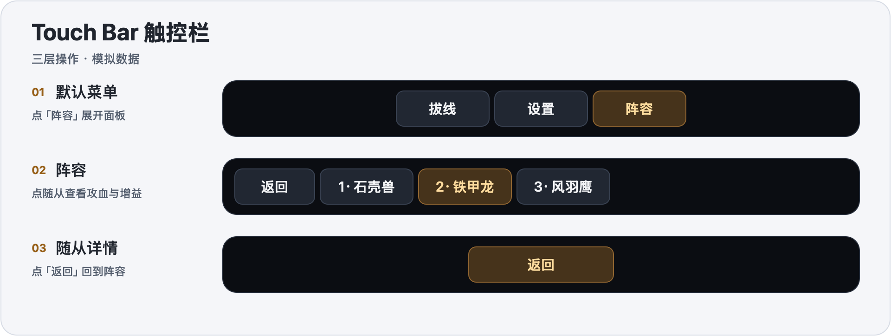
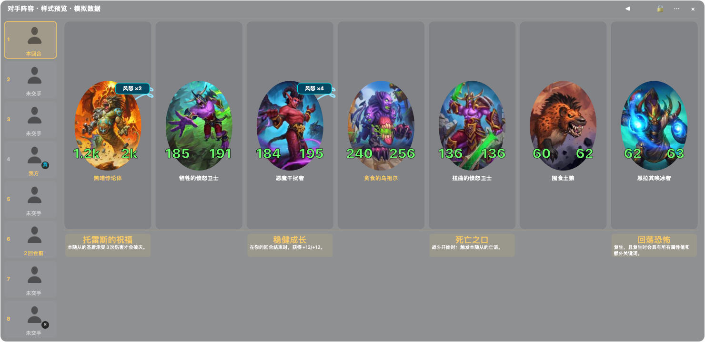

# 酒馆战棋助手

面向 macOS 的《炉石传说》酒馆战棋助手。1.0.0 在同一个应用内运行 HSTracker 3.7.0 记牌器、阵容与增益记录、Touch Bar 控件。从顶部菜单栏进入设置，游戏内可展开或收起阵容浮窗。

## 功能

- **记牌、战绩与胜率模拟**。保留 HSTracker 的记牌和战棋模拟界面。最近战绩可显示 5、8 或 10 场，结算入库后刷新。连续两小时没有完成新对局时，当前会话的战绩面板会清空，已保存的记录可在历史里查看。
- **对手阵容记录**。左侧英雄按游戏提供的排名更新，标记几回合前交手，换位后保留已选对手。显示已观察到的阵容和攻血，战斗中的死亡与临时变化不会让主面板不断跳动。尚未看到的对手阵容不显示。
- **随从和增益**。卡图下方左攻右血，千位起缩写为 `k`，详情保留原值。卡面标出圣盾、风怒等效果，黑暗之赐等额外机制在独立一栏展示。点击随从可查看已识别的增益来源与效果说明，具体内容取决于日志和卡牌资料。
- **浮窗与快捷键**。支持拖动、缩放、锁定和透明度预览。炉石在前台时，`⌃⌥B` 展开或收起阵容，`⌃⌥D` 查看鼠标指向的随从，`⌃⌥←` 返回上一级。
- **Touch Bar**。顶层提供拔线、设置和阵容入口。进入阵容后切换到随从操作，详情层显示返回按钮。拔线由玩家主动触发。
- **游戏资料更新**。从菜单栏更新卡牌、增益及标签资料。游戏日志或模拟规则有结构性变化时，需要新版助手。HSReplay Tier7 由其服务方管理，使用对应的账户资格。

## Touch Bar 触控栏

在配有 Touch Bar 的 MacBook Pro 上，炉石窗口在前台时会显示助手控件。

- **默认菜单**显示「拔线」「设置」和「阵容」。「设置」打开「触控栏与重连」。
- **阵容菜单**显示当前阵容的随从按钮和「返回」。点按随从可打开其攻血与增益详情。
- **随从详情**仅在触控栏中间显示「返回」，点按后回到当前阵容。
- 如需重新显示控件，可在助手的菜单栏菜单或「触控栏与重连」里点「重新显示触控栏」，再切回炉石。

也可以用游戏内拔线浮窗或快捷键操作。菜单栏的「显示拔线悬浮按钮」可打开浮窗，「触控栏与重连」可以调整拔线快捷键和锁定浮窗位置。

## 界面预览

下图由本地预览程序使用模拟数据渲染。

## 安装

适用于 Apple 芯片 Mac，要求 macOS 12 或更新版本。记牌器已内置，安装完成后即可和炉石一起使用。

1. 从 [1.0.0 发布页](https://github.com/pro1433223-sketch/taverntracker-enhanced/releases/tag/v1.0.0) 下载 ZIP 并解压。
2. 将「酒馆战棋助手.app」拖到「应用程序」并打开。若已有同名助手在运行，先退出旧实例。
3. 如果 macOS 拦截首次打开，先尝试启动 App，再前往「系统设置 → 隐私与安全性」点「仍要打开」。发布包采用本地签名，未经 Apple 公证。[Apple 打开应用说明](https://support.apple.com/zh-cn/102445)
4. 若系统提示需要屏幕录制或辅助功能权限，按提示授权。也可从助手菜单栏选「辅助功能授权…」。

发布页提供 ZIP 的 SHA-256 校验值。

## Clash／Mihomo 拔线设置

拔线需要本机运行带外部控制器的 Clash／Mihomo，且炉石连接经过该代理。记牌、战绩、阵容和随从增益可直接随炉石使用。

1. 启动 Clash／Mihomo，确保已启用外部控制器。助手可读取常见的 Clash Verge Rev 本地套接字，以及 Clash 或 Clash Verge Rev 的配置文件。
2. 在助手菜单栏打开「设置… → 触控栏与重连」，点击「刷新状态」。如果显示「未找到代理控制器」或「控制器未启动」，在 Clash 客户端检查控制器设置后重新打开助手。
3. 进入酒馆战棋对局并让炉石在前台。使用触控栏「拔线」、游戏内悬浮按钮或已设置的拔线快捷键。

## 第三方来源

记牌器基于 [HearthSim/HSTracker](https://github.com/HearthSim/HSTracker) 的 3.7.0 源码。游戏素材及数据归 Blizzard Entertainment。此项目为个人整合版本。[第三方来源与许可](THIRD_PARTY_NOTICES.md)
